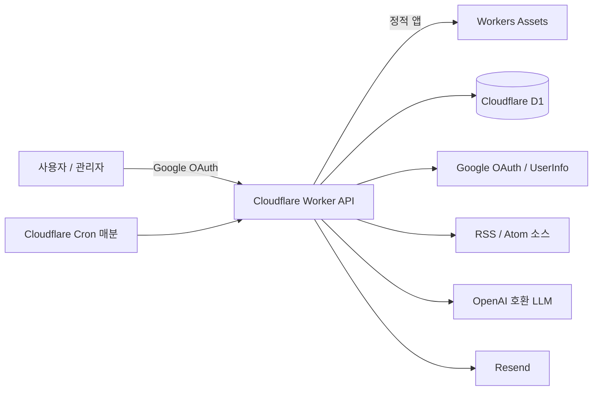

# 시스템 설계

## 구성도

## 런타임 경계

- `src/index.js`: HTTP 라우팅, Google OAuth callback, 세션, 초대/관리자 권한 확인, API 입력 검증, 관리자 동작.
- `src/digest.js`: RSS/Atom 수집, LLM 호출, D1 날짜 잠금, 예약/수동 발송, 만료 정리.
- `src/mailer.js`: 제한된 Markdown→HTML 렌더링 및 Resend 단건 메일 발송.
- `public/`: 정적 UI, CSS 및 배포 시 Worker가 읽는 프롬프트.
- `migrations/`: D1 스키마 및 기본값.

## Google OAuth와 세션

1. `/auth/google`은 무작위 OAuth `state`와 10분 만료 시각을 D1에 저장하고 HttpOnly 쿠키에도 같은 state를 둔다.
2. `/auth/callback`은 쿠키와 DB state를 대조·소비하고 Google token endpoint에서 코드를 교환한다.
3. Google UserInfo의 검증된 이메일이 초대되었거나 이미 등록되었거나 부트스트랩 관리자여야 가입된다.
4. 256-bit 무작위 세션 토큰은 HttpOnly/SameSite=Lax 쿠키로 전달하고, SHA-256 해시만 D1에 저장한다. 유효기간은 30일이다.
5. Worker는 Google과 직접 통신하므로 OAuth callback과 관련 비밀값을 앱 배포 환경에서 관리한다.

## 일일 브리핑 파이프라인

1. Cron은 매분 실행한다. 현재 현지 분이 관리자 설정의 `send_time`과 맞을 때에만 파이프라인을 시작한다.
2. 시간대 기준 날짜를 구하고 `digest_locks`에 날짜 잠금을 만든다. 이미 완료 또는 처리 중인 날짜는 두 번 시작하지 않는다. 실패 상태는 재시도 가능하다.
3. 활성 구독자가 없으면 `no_subscribers` 실행 결과를 기록하고 외부 API를 호출하지 않는다.
4. 활성 RSS/Atom 피드를 병렬로 읽고 게시 시각이 현재 시각 기준 최근 24시간 이내인 모든 항목을 선택한다. 날짜가 없거나 파싱되지 않는 항목은 제외하며, 소스 실패는 다른 소스 처리를 막지 않는다.
5. 중복 URL을 하나로 합치고 출처명을 모두 보존한다. LLM은 기사 제목에서 직접 확인되는 한국 단서의 정확한 인용 근거를 반환해야 한국 관련 후보로 인정한다. 요약문에만 한국이 배경·비교 대상으로 잠깐 언급되거나 근거가 제목에 없으면 제외한다. 통과한 기사 URL만 재검증 후 최대 2MB HTML을 받아 본문 텍스트 최대 6,000자로 추출한다. 본문 요청 실패는 RSS 요약으로 대체한다.
6. 기사별 요약 제목에 feed 원본 timezone을 유지한 게시 시각을 표시한다. 기사 묶음을 한국어 중간 요약 후 전체 브리핑으로 합성한다. 한국 관련 기사 본문이 있으면 내용에 기반해 상단에 배치한다. 생성 뒤 실제 제목·원본 timezone 게시 일시·URL·미디어명을 포함한 출처 섹션을 코드가 붙여 날짜별 저장한다.
7. 각 구독자에게 별도의 Resend 메일을 전송한다. `UNIQUE(date,user_id)`로 성공 수신자 중복을 막고 실패 레코드는 재시도할 수 있다.
8. 사용자별 결과와 실행 집계를 기록한다. 실패는 다음 수동 실행 또는 실패 잠금 재시도에서 재처리할 수 있다.

## 문서 결정

- 날짜 키는 설정한 IANA 시간대의 `YYYY-MM-DD`다. 저장 타임스탬프는 UTC ISO 8601이다.
- 뉴스 요약은 동일 날짜에 구독자 공통 1개다. 최근 24시간 RSS 항목 전체를 대상으로 하고 결과는 한국어다.
- 수동 테스트 이메일은 실제 생성된 요약을 관리자 본인에게 보낸다. 테스트 실행은 일일 전달 잠금을 소비하지 않는다.
- Cloudflare가 Firebase 실행 요소를 대체한다. Firebase는 의존성이나 운영 서비스가 아니다.
- Google OAuth client secret은 Cloudflare Worker secret으로 등록하고 브라우저 자산이나 D1에는 저장하지 않는다.